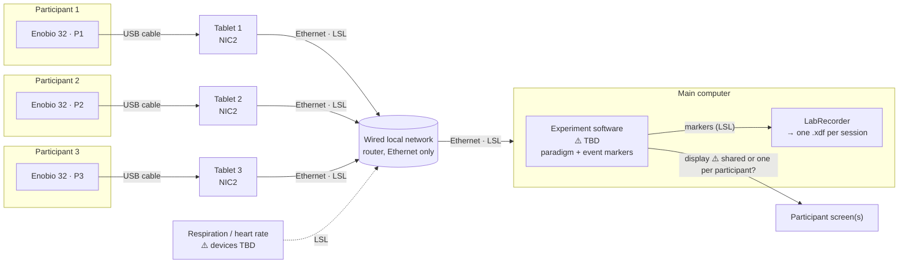

# lab-intercom-study-cu

Recording setup for a three-person EEG hyperscanning study: three participants
wear an Enobio 32 each, while they take part in a shared experimental paradigm.
All data (EEG, task events, and other physiological signals) is recorded into
one file on one timeline.

> **Status: draft.** The approach below is decided; the bench test that
> validates it has not been run yet. Open points are marked ⚠️ and listed in
> [Open points](#open-points).

## Approach

- **One tablet per participant, connected by USB cable.** Each Enobio is
  plugged into its own Windows tablet running Neuroelectrics' NIC2. NIC2 handles the device connection,
  signal quality and clock synchronization, and publishes the data as LSL
  streams.
- **One main computer for everything else.** It runs the experimental paradigm
  shown to participants, records all streams with LabRecorder, and hosts any
  other data collection.
- **Everything wired, no Wi-Fi.** Enobios connect to their tablets over USB,
  and the tablets connect to the main computer over a wired local network
  (Ethernet). The router only provides that wired network; no Wi-Fi is used
  for now.
- **LSL (Lab Streaming Layer) as the common language.** Every source publishes
  LSL streams on the local network; LabRecorder saves them together in one XDF
  file, with the clock offsets needed to put all computers on one timeline.

## Diagram

## Components

| Where | What | Role |
|---|---|---|
| Participant | Enobio 32 (×3, labelled P1–P3) | 32-channel EEG + accelerometer, connected to its tablet by USB cable. |
| Tablet (×3) | NIC2 | Connects to its Enobio over USB, runs the synchronizer ⚠️, publishes `Pn-EEG`, `Pn-Accelerometer`, `Pn-Quality`, `Pn-Markers` over LSL. Also saves its own file as a backup. |
| Tablet ↔ main computer | Wired local network (router, USB Ethernet adapters) | Carries LSL. The router's Wi-Fi is not used. Neuroelectrics recommends a wired network when LSL is on. |
| Main computer | Experiment software ⚠️ | Shows the paradigm to participants and sends event markers as an LSL stream. |
| Main computer | LabRecorder | Records every LSL stream (EEG, markers, physiology) into one XDF file per session. |
| Main computer | Other LSL sources ⚠️ | Respiration and heart-rate devices, connected here or elsewhere on the network. |

### How timing works

1. **Enobio → tablet:** NIC2's synchronizer aligns each Enobio's clock to its
   tablet. It takes a few minutes after connecting; NIC2 blocks recording until
   it is accurate enough. Neuroelectrics documents it for Wi-Fi; whether it
   runs the same way over USB still has to be confirmed ⚠️.
2. **Tablet → main computer:** LSL measures the clock offset between each
   tablet and the main computer throughout the recording, and LabRecorder
   stores it in the file.
3. **Analysis:** loading the XDF file applies those offsets, so all three
   participants, the task events and the physiology share one timeline.

Whether step 1 produces timestamps that LSL can use directly is what the bench
test checks ⚠️.

## Repository

| Path | Contents |
|---|---|
| [`bench/`](bench/README.md) | Bench test: procedure, stream check (`check_streams.py`) and recording analysis (`analyze_recording.py`) |
| [`BACKLOG.md`](BACKLOG.md) | Everything still to do, decide or ask, and what is already decided |
| [`AV_SYSTEM.md`](AV_SYSTEM.md) | Questions for the lab assistant about the testing room's cameras, microphones, displays and network, and how we could use them |
| `environment.yml` | Conda environment `lab-intercom-study-cu` for our Python tools |
| `.vscode/tasks.json` | VS Code tasks to set up the environment and run the bench scripts |

Our Python tools run on the main computer only; nothing from this repository
is installed on the tablets.

## Open points

Details and the full list are in [BACKLOG.md](BACKLOG.md).

**Validate the setup**
- ⚠️ Confirm NIC2 connects to an Enobio over USB and that its synchronizer
  works (or is needed) over USB.
- ⚠️ Tablet ports: each tablet needs USB for the Enobio and for the Ethernet
  adapter, possibly power too. Check the ports, or plan a hub.
- ⚠️ Electrical safety of a participant cabled to a tablet: keep tablets on
  battery during recording, or check with Neuroelectrics / the ethics board.
- ⚠️ Run the bench test (three tablets + main computer) and fill in the results.
- ⚠️ Confirm NIC2's LSL timestamps are on the LSL clock once its synchronizer is done.
- ⚠️ Millisecond-level timing check across the three Enobios (shared electrical
  test signal), and a short timing check to run at every session.

**Experimental paradigm**
- ⚠️ Choose the experiment software and define the paradigm (not finalized).
- ⚠️ Decide how participants see it: one shared screen, or one screen each.
- ⚠️ Design the marker stream (name, format, event codes).
- ⚠️ Measure the delay between a marker and the moment the stimulus is
  actually on screen (e.g. photodiode).

**Other data collection**
- ⚠️ Respiration and heart-rate devices: make/model, how many, sampling
  rates, timestamping, and which computer they connect to.

**AV system in the testing room** (questions in [AV_SYSTEM.md](AV_SYSTEM.md))
- ⚠️ What the cameras' Ethernet cables carry (NDI, NDI|HX, RTSP, HDBaseT, ...)
  and whether we can record video and audio in sync with the EEG.
- ⚠️ How the main computer drives the room display(s), and their delay.
- ⚠️ Our own router for LSL, or the lab's network.

**Session operation**
- ⚠️ Cable length and routing, so participants can move as the paradigm needs.
- ⚠️ Per-tablet session checklist and a single "all ready" start.
- ⚠️ Recording conventions: file naming, IDs, storage, NIC2 backup files.
- ⚠️ Channel labels for the 32-channel montage.

**Questions for Neuroelectrics**
- ⚠️ EEG units in NIC2's LSL output, which clock its timestamps use, whether
  the synchronizer works over USB and keeps correcting during long sessions,
  safe use of a USB-connected Enobio on a participant, and the accelerometer
  rate.
