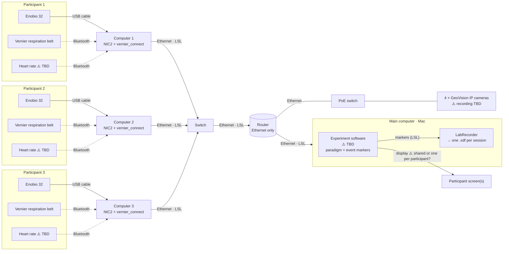

# lab-intercom-study-cu

Recording setup for a three-person EEG hyperscanning study: three participants
wear an Enobio 32 each, while they take part in a shared experimental paradigm.
All data (EEG, task events, and other physiological signals) is recorded into
one file on one timeline.

> **Status: draft.** The approach below is decided; the bench test that
> validates it has not been run yet. Open points are marked ⚠️ and listed in
> [Open points](#open-points).

## Approach

- **One computer per participant.** Each participant's Enobio is plugged by
  USB cable into its own Windows computer running Neuroelectrics' NIC2. NIC2
  handles the device connection, signal quality and clock synchronization, and
  publishes the data as LSL streams. The participant's respiration and
  heart-rate sensors connect to the same computer over Bluetooth.
- **One main computer for everything else.** It runs the experimental paradigm
  shown to participants and records all streams with LabRecorder.
- **Wired network.** The participant computers connect over Ethernet to a
  switch, and that switch to the router. The router also connects a second
  switch for the room's cameras, and the main computer. The router's Wi-Fi is
  not used.
- **LSL (Lab Streaming Layer) as the common language.** Every source publishes
  LSL streams on the local network; LabRecorder saves them together in one XDF
  file, with the clock offsets needed to put all computers on one timeline.

## Diagram

## Components

| Where | What | Role |
|---|---|---|
| Participant | Enobio 32 (×3, labelled P1–P3) | 32-channel EEG + accelerometer, connected to its computer by USB cable. |
| Participant | Respiration belt: Vernier Go Direct GDX-RB (×3, Belt A–C = P1–P3) | Connected to the participant's computer over Bluetooth; [`respiration/vernier_connect.py`](respiration/README.md) publishes it as an LSL stream `GDX-RB_<serial>`. |
| Participant | Heart-rate sensor ⚠️ (one per participant) | Connected to the participant's computer over Bluetooth, published as an LSL stream. |
| Participant computer (×3) | NIC2 | Connects to its Enobio over USB, runs the synchronizer ⚠️, publishes `Pn-EEG`, `Pn-Accelerometer`, `Pn-Quality`, `Pn-Markers` over LSL. Also saves its own file as a backup. Also receives the participant's respiration and heart-rate sensors. |
| Network | Switch for the participant computers, router, PoE switch for the cameras | Carries LSL. The router's Wi-Fi is not used. Neuroelectrics recommends a wired network when LSL is on. |
| Room | 4 × GeoVision IP cameras | Powered and connected by the PoE switch, on the same network. How they are recorded is still open ⚠️. |
| Main computer (Mac) | Experiment software️ | Shows the paradigm to participants and sends event markers as an LSL stream. |
| Main computer (Mac) | LabRecorder | Records every LSL stream (EEG, markers, physiology) into one XDF file per session. |

### How timing works

1. **Enobio → participant computer:** NIC2's synchronizer aligns each Enobio's
   clock to its computer. It takes a few minutes after connecting; NIC2 blocks
   recording until it is accurate enough. Neuroelectrics documents it for
   Wi-Fi; whether it runs the same way over USB still has to be confirmed ⚠️.
2. **Respiration belt → participant computer:** the Vernier belt connects over
   Bluetooth, and `vernier-lsl` timestamps each sample when it arrives at the
   computer, not when the belt measured it, so the Bluetooth delay is in the
   timestamps ⚠️ (to measure).
   **Heart rate → participant computer:** also Bluetooth; whether the sensor
   timestamps at measurement or on arrival depends on the sensor, still to be
   chosen ⚠️.
3. **Participant computer → main computer:** LSL measures the clock offset
   between each participant computer and the main computer throughout the
   recording, and LabRecorder stores it in the file.
4. **Analysis:** loading the XDF file applies those offsets, so all three
   participants, the task events and the physiology share one timeline.

Whether step 1 produces timestamps that LSL can use directly is what the bench
test checks ⚠️.

## Repository

| Path | Contents |
|---|---|
| [`bench/`](bench/README.md) | Bench test: procedure, stream check (`check_streams.py`) and recording analysis (`analyze_recording.py`) |
| [`respiration/`](respiration/README.md) | `vernier_connect.py`: connects one respiration belt over Bluetooth and streams it to LSL, restarting it if it drops (runs on each participant computer) |
| `environment.yml` | Conda environment `lab-intercom-study-cu` for our Python tools |
| `.vscode/tasks.json` | VS Code tasks to set up the environment and run the bench scripts |

Our Python tools run on the main computer, with one exception:
`respiration/vernier_connect.py` runs on each participant computer, from a
clone of this repository with the same conda env, via the VS Code task
**Respiration: connect belt** (see [respiration/README.md](respiration/README.md)).
Nothing else from this repository is run on the participant computers.

## Open points

**Experimental paradigm**
- ⚠️ Choose the experiment software and define the paradigm (not finalized).
- ⚠️ Decide how participants see it: one shared screen, or one screen each.
- ⚠️ Design the marker stream (name, format, event codes).
- ⚠️ Measure the delay between a marker and the moment the stimulus is
  actually on screen (e.g. photodiode).

**Respiration and heart rate**
- Respiration: Vernier GDX-RB belts, one per seat, tracked by the session
  monitor as `P1-Respiration` … `P3-Respiration` (not required yet). Details
  and open points in [respiration/README.md](respiration/README.md).

- ⚠️ Heart rate: make/model of the sensor, sampling rate, and whether it
  timestamps at measurement or on arrival over Bluetooth.
- ⚠️ Add both to the bench test: check they appear in LSL and record next to
  the EEG.

**Lab network**

- ⚠️ The cameras are on a different subnet from the rest of the network and
  must be moved onto it.

**AV system in the testing room**
- ⚠️ How to record the GeoVision cameras (and audio) in sync with the EEG.
- ⚠️ How the main computer drives the room display(s), and their delay.

**Session operation**
- ⚠️ Cable length and routing, so participants can move as the paradigm needs.
- ⚠️ Per-computer session checklist and a single "all ready" start.
- ⚠️ Recording conventions: file naming, IDs, storage, NIC2 backup files.
- ⚠️ Channel labels for the 32-channel montage.

