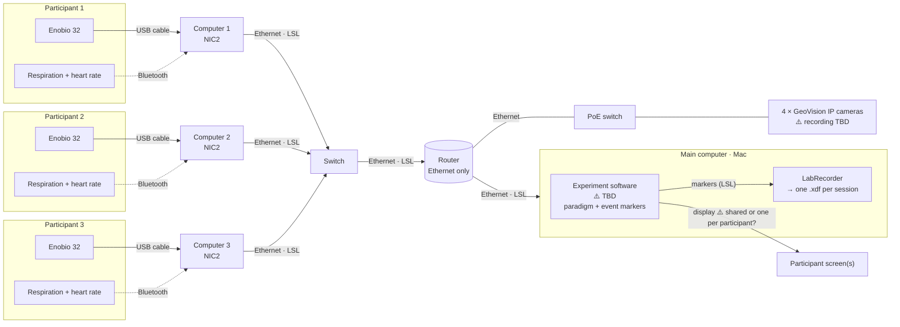

# lab-intercom-study-cu

Recording setup for a three-person EEG hyperscanning study: three participants
wear an Enobio 32 each, while they take part in a shared experimental paradigm.
All data (EEG, task events, and other physiological signals) is recorded into
one file on one timeline.

> **Status: draft.** The approach below is decided; the bench test that
> validates it has not been run yet. Open points are marked ⚠️ and listed in
> [Open points](#open-points).

## Approach

- **One computer per participant.** Each participant's Enobio is plugged by
  USB cable into its own Windows computer running Neuroelectrics' NIC2. NIC2
  handles the device connection, signal quality and clock synchronization, and
  publishes the data as LSL streams. The participant's respiration and
  heart-rate sensors connect to the same computer over Bluetooth.
- **One main computer for everything else.** It runs the experimental paradigm
  shown to participants and records all streams with LabRecorder.
- **Wired network.** The participant computers connect over Ethernet to a
  switch, and that switch to the router. The router also connects a second
  switch for the room's cameras, and the main computer. The router's Wi-Fi is
  not used.
- **LSL (Lab Streaming Layer) as the common language.** Every source publishes
  LSL streams on the local network; LabRecorder saves them together in one XDF
  file, with the clock offsets needed to put all computers on one timeline.

## Diagram

## Components

| Where | What | Role |
|---|---|---|
| Participant | Enobio 32 (×3, labelled P1–P3) | 32-channel EEG + accelerometer, connected to its computer by USB cable. |
| Participant | Respiration and heart-rate sensors ⚠️ (one set per participant) | Connected to the participant's computer over Bluetooth, published as LSL streams. |
| Participant computer (×3) | NIC2 | Connects to its Enobio over USB, runs the synchronizer ⚠️, publishes `Pn-EEG`, `Pn-Accelerometer`, `Pn-Quality`, `Pn-Markers` over LSL. Also saves its own file as a backup. Also receives the participant's respiration and heart-rate sensors. |
| Network | Switch for the participant computers, router, PoE switch for the cameras | Carries LSL. The router's Wi-Fi is not used. Neuroelectrics recommends a wired network when LSL is on. |
| Room | 4 × GeoVision IP cameras | Powered and connected by the PoE switch, on the same network. How they are recorded is still open ⚠️. |
| Main computer (Mac) | Experiment software ⚠️ | Shows the paradigm to participants and sends event markers as an LSL stream. |
| Main computer (Mac) | LabRecorder | Records every LSL stream (EEG, markers, physiology) into one XDF file per session. |

### How timing works

1. **Enobio → participant computer:** NIC2's synchronizer aligns each Enobio's
   clock to its computer. It takes a few minutes after connecting; NIC2 blocks
   recording until it is accurate enough. Neuroelectrics documents it for
   Wi-Fi; whether it runs the same way over USB still has to be confirmed ⚠️.
2. **Respiration / heart rate → participant computer:** Bluetooth devices
   often timestamp samples when they arrive at the computer, not when they are
   measured, which adds a delay ⚠️.
3. **Participant computer → main computer:** LSL measures the clock offset
   between each participant computer and the main computer throughout the
   recording, and LabRecorder stores it in the file.
4. **Analysis:** loading the XDF file applies those offsets, so all three
   participants, the task events and the physiology share one timeline.

Whether step 1 produces timestamps that LSL can use directly is what the bench
test checks ⚠️.

## Repository

| Path | Contents |
|---|---|
| [`bench/`](bench/README.md) | Bench test: procedure, stream check (`check_streams.py`) and recording analysis (`analyze_recording.py`) |
| `environment.yml` | Conda environment `lab-intercom-study-cu` for our Python tools |
| `.vscode/tasks.json` | VS Code tasks to set up the environment and run the bench scripts |

Our Python tools run on the main computer only; nothing from this repository
is installed on the participant computers.

## Open points

**Validate the setup**
- ⚠️ Confirm NIC2 connects to an Enobio over USB and that its synchronizer
  works (or is needed) over USB.
- ⚠️ Electrical safety of a participant cabled by USB to a computer: check
  with Neuroelectrics / the ethics board.
- ⚠️ Run the bench test (three participant computers + main computer) and
  fill in the results.
- ⚠️ Confirm NIC2's LSL timestamps are on the LSL clock once its synchronizer is done.
- ⚠️ Millisecond-level timing check across the three Enobios (shared electrical
  test signal), and a short timing check to run at every session.

**Experimental paradigm**
- ⚠️ Choose the experiment software and define the paradigm (not finalized).
- ⚠️ Decide how participants see it: one shared screen, or one screen each.
- ⚠️ Design the marker stream (name, format, event codes).
- ⚠️ Measure the delay between a marker and the moment the stimulus is
  actually on screen (e.g. photodiode).

**Respiration and heart rate**
- ⚠️ Make/model of the sensors, sampling rates, and whether they timestamp at
  measurement or on arrival over Bluetooth.
- ⚠️ Add them to the bench test: check they appear in LSL and record next to
  the EEG.

**Lab network**
- ⚠️ LabRecorder on the Mac does not see NIC2's streams since a switch was
  added.
- ⚠️ The cameras are on a different subnet from the rest of the network and
  must be moved onto it.

**AV system in the testing room**
- ⚠️ How to record the GeoVision cameras (and audio) in sync with the EEG.
- ⚠️ How the main computer drives the room display(s), and their delay.

**Session operation**
- ⚠️ Cable length and routing, so participants can move as the paradigm needs.
- ⚠️ Per-computer session checklist and a single "all ready" start.
- ⚠️ Recording conventions: file naming, IDs, storage, NIC2 backup files.
- ⚠️ Channel labels for the 32-channel montage.

**Questions for Neuroelectrics**
- ⚠️ EEG units in NIC2's LSL output, which clock its timestamps use, whether
  the synchronizer works over USB and keeps correcting during long sessions,
  safe use of a USB-connected Enobio on a participant, and the accelerometer
  rate.
